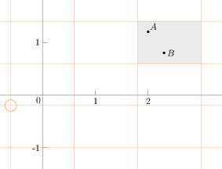

RectangularLattice
^^^^^^^^^^^^^^^^^^

The ``RectangularLattice`` is a helper class that maps all of N-D space into
a regular, rectangular grid of cells identified by integer coordinates.  The
grid is defined by an origin point and a vector indicating spacing in each dimension.

The figure shows an example ``RectangularLattice`` in 2D, with its origin
(circled) at (-0.6, -0.2) and spacing (1.2, 0.8).  Given a query point, the
``RectangularLattice`` will return the coordinates of the cell that contains the
point.  It will also return the bounding box of a cell, or the coordinates of a
cell's lower-left corner.

The following example shows the use of the ``RectangularLattice``.  First, include
the header and (if desired) declare type aliases.  Using ``const int in2d = 2``
makes a 2D lattice.

.. literalinclude:: ../../examples/spin_introduction.cpp
   :start-after: _rectlattice_header_start
   :end-before: _rectlattice_header_end
   :language: C++

Use the ``RectangularLattice`` to find grid cells.

.. literalinclude:: ../../examples/spin_introduction.cpp
   :start-after: _rectlattice_use_start
   :end-before: _rectlattice_use_end
   :language: C++

Mortonizer
^^^^^^^^^^

The ``Mortonizer`` (along with its associated class ``MortonBase``) implements
the Morton index, an operation that associates each point in N-D space with a
point on a space-filling curve [#f1]_.  The ``PointHash`` class adapts the
``Mortonizer`` to provide a hashing functionality for use with
``std::unordered_map``, ``axom::FlatMap`` or similar container classes.

The math of the Morton index works with integers.  Thus, the ``Mortonizer`` and
its dependent class ``PointHash`` will not work with floating point coordinates.
The following code example shows how the cells of a ``RectangularLattice``,
which have integer coordinates, can be used with a hash table.

The ``Mortonizer`` works by interleaving bits from each coordinate of the input
point and finite computer hardware limits its resolution.  If the
``MortonIndexType`` is 64-bits, then in 2D it can uniquely index the least
significant 32 bits of the x- and y-coordinates.  In 3D, it can uniquely index
the least significant 21 bits of the x-, y-, and z-coordinates.

To use the ``PointHash``, include the header and (as desired) declare type aliases.

.. literalinclude:: ../../examples/spin_introduction.cpp
   :start-after: _morton_header_start
   :end-before: _morton_header_end
   :language: C++

The ``RectangularLattice`` grid cell associated with a query point can be
stored, using a ``PointHash``, in a ``std::unordered_map``.

.. literalinclude:: ../../examples/spin_introduction.cpp
   :start-after: _morton_use_start
   :end-before: _morton_use_end
   :language: C++

Hilbertizer
^^^^^^^^^^^

``Hilbertizer<CoordType, IndexType, DIM>`` encodes integer lattice points as
Hilbert indices and decodes them in 2D, 3D, or 4D. It uses Skilling's scalar
axes/transpose algorithm [#f2]_. Host and device code share this implementation,
which packs bit planes without lookup tables.

.. code-block:: cpp

   #include "axom/spin/HilbertIndex.hpp"
   #include <cstdint>

   using H = axom::spin::Hilbertizer<std::int64_t, std::uint64_t, 3>;
   const H::PointType point {5, 10, 20};
   const int bits = 5;
   const auto index = H::toIndex(point, bits);  // 7865
   const auto decoded = H::toPoint(index, bits);  // {5, 10, 20}

At a valid depth ``bits``, each integer point in ``[0, 2^bits - 1]^DIM`` maps
to exactly one index in ``[0, 2^(DIM * bits) - 1]``, and vice versa. Use the
same depth to encode and decode. Store the dimension and depth with the key.

Axis zero occupies the most significant bit in each interleaved bit plane.
At depth one, the 2D curve visits ``(0,0)``, ``(0,1)``, ``(1,1)``, and ``(1,0)``.

Coordinate and index types must be integers other than ``bool``, at most 64
bits wide. Signed types use only nonnegative values. The maximum depth is
``MAX_UNIQUE_BITS = min(COORD_BITS, INDEX_BITS / DIM)``, where the bit counts
exclude sign bits. ``maxBitsPerCoord()`` returns this limit. Both conversions
use it when ``bits`` is omitted. Narrow coordinate types can reduce the limits
shown below.

.. list-table:: Maximum bits per coordinate
   :header-rows: 1

   * - Index type
     - 2D
     - 3D
     - 4D
   * - ``uint32_t``
     - 16
     - 10
     - 8
   * - ``int32_t``
     - 15
     - 10
     - 7
   * - ``uint64_t``
     - 32
     - 21
     - 16
   * - ``int64_t``
     - 31
     - 21
     - 15

Use ``isValidDepth(bits)``, ``isValidPoint(point, bits)``, and
``isValidIndex(index, bits)`` to check inputs. Depth zero, negative values, and
values beyond the selected depth are invalid. Conversion functions require
valid inputs. Debug assertions check these preconditions. Release builds leave
these checks to the caller. Neither conversion clamps inputs.

The free functions ``convertPointToHilbert<IndexType>(point, bits)`` and
``convertHilbertToPoint<CoordType, DIM>(index, bits)`` call ``toIndex`` and
``toPoint``. They use the same preconditions and default depth.

Quantize floating-point positions before encoding, for example with
``RectangularLattice::gridCell()``. The lattice is unbounded. Check that each
cell coordinate is nonnegative and fits the selected depth before encoding.
Decoding returns the integer cell coordinates.

.. rubric:: Footnotes

.. [#f1] The Morton index is also known, among other things, as the Z-order curve: 
         see its `Wikipedia page <https://wikipedia.org/wiki/Z-order_curve>`_.
.. [#f2] John Skilling, "Programming the Hilbert curve", AIP Conference
         Proceedings 707, 381 (2004),
         `doi:10.1063/1.1751381 <https://doi.org/10.1063/1.1751381>`_.
